<p align="center">
  
</p>

<h1 align="center">DiskLens</h1>

<p align="center">
  <b>Entiende qué ocupa tu disco en Windows, y por qué desaparece el espacio libre.</b><br>
  De lo general (categorías) a lo concreto (archivo por archivo), con línea de tiempo, limpieza segura y asistente de IA.
</p>

<p align="center">
  <a href="README.md">English</a> · <a href="README.pt-BR.md">Português</a> · <b>Español</b>
</p>

<p align="center">
  
  
  
  
  
</p>

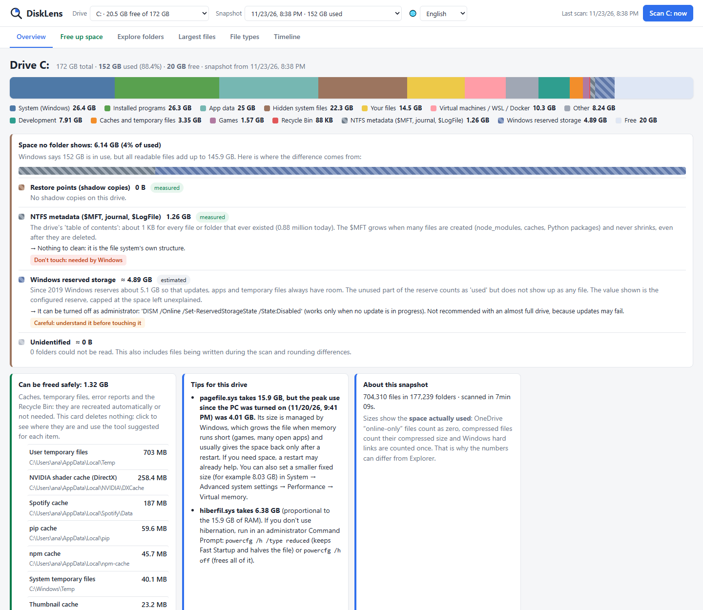

<sub>Las capturas están en inglés; en la aplicación, elige Español con el selector 🌐.</sub>

---

## Por qué existe DiskLens

Un día el disco tiene 20 GB libres. Unos días después tiene 10 GB, y no instalaste nada. Las herramientas de Windows muestran *cuánto* está ocupado, pero no **qué**, ni **cuándo** cambió.

DiskLens responde tres preguntas:

1. **¿Qué ocupa el disco ahora?** Cada carpeta y cada archivo, agrupados en categorías con sentido (sistema, programas, cachés, máquinas virtuales, tus archivos…), cada una con una explicación sencilla y el nivel de seguridad para limpiarla.
2. **¿Qué cambió, y cuándo?** Mide el disco cada 15 minutos, hace una instantánea completa al día y lee el diario de cambios de NTFS. Así muestra **qué archivo** creció y en **qué intervalo de 15 minutos**.
3. **¿Qué puedo borrar sin romper nada?** Una pestaña de limpieza separa lo seguro (cachés y temporales), lo que solo tú puedes decidir (archivos personales, que van a la Papelera) y lo que solo se quita con el desinstalador oficial. Un asistente de IA, de cualquier proveedor, te ayuda a decidir.

También muestra el espacio que **ninguna carpeta muestra**: puntos de restauración, almacenamiento reservado de Windows, metadatos de NTFS, pagefile e hiberfil.

---

## Índice

- [Funciones](#funciones)
- [Instalación](#instalación)
- [Cómo usarlo](#cómo-usarlo)
- [Seguridad: lo que DiskLens nunca hace](#seguridad-lo-que-disklens-nunca-hace)
- [No estorba al usar el PC](#no-estorba-al-usar-el-pc)
- [Privacidad](#privacidad)
- [Cómo funciona por dentro](#cómo-funciona-por-dentro)
- [Pruebas](#pruebas)
- [Preguntas frecuentes](#preguntas-frecuentes)
- [Apoya el proyecto](#apoya-el-proyecto)

---

## Funciones

### Resumen y espacio oculto

La barra del disco muestra cada categoría con su color. Debajo, la tarjeta **"Espacio que ninguna carpeta muestra"** explica la diferencia entre lo que Windows dice que está en uso y la suma de todos los archivos legibles:

| Elemento | Cómo se mide |
|---|---|
| Puntos de restauración (instantáneas) | WMI `Win32_ShadowStorage` y `Get-ComputerRestorePoint` |
| Almacenamiento reservado de Windows | registro `ReserveManager` |
| Metadatos de NTFS (`$MFT`, diario, `$LogFile`) | `FSCTL_GET_NTFS_VOLUME_DATA` y `FSCTL_QUERY_USN_JOURNAL` |
| Carpetas protegidas | leídas como administrador con `SeBackupPrivilege` (solo lectura) |
| pagefile.sys / hiberfil.sys | WMI `Win32_PageFileUsage` y configuración de energía |

Cada elemento indica si el valor fue **medido** o **estimado**, qué es y qué puedes hacer al respecto.

### Liberar espacio

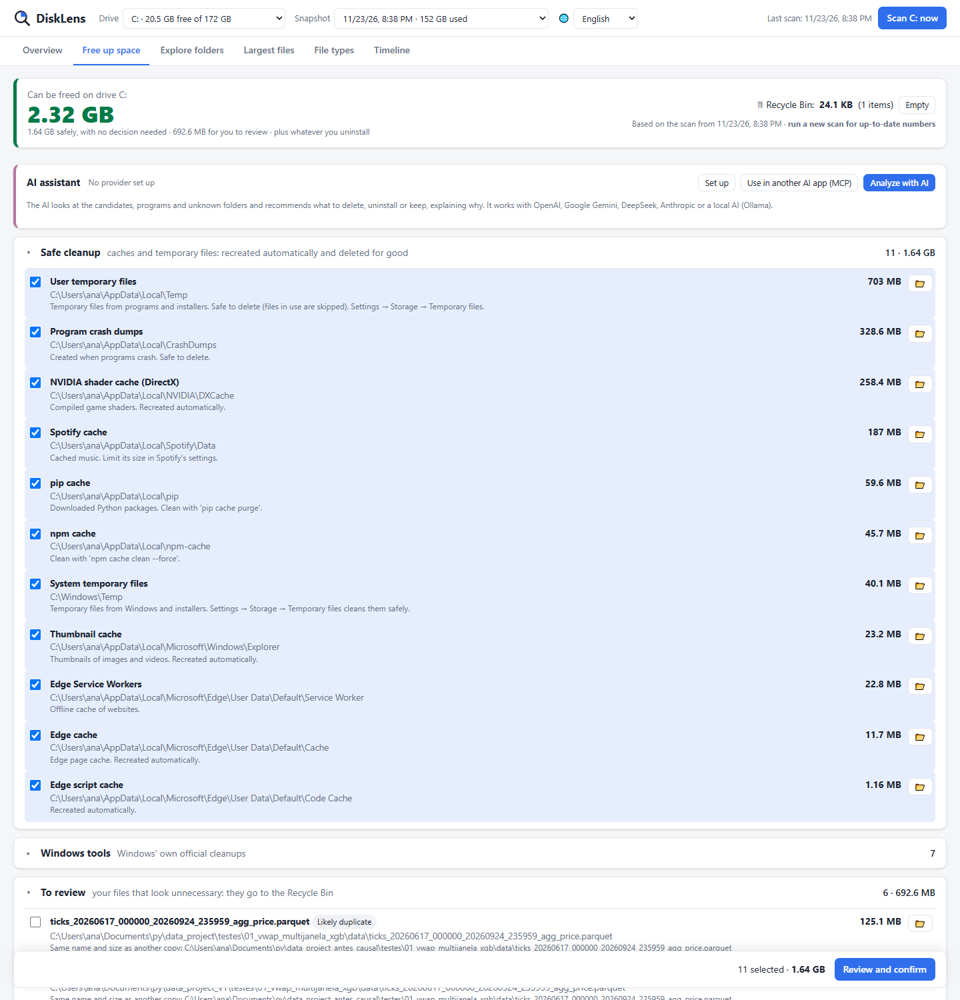

La pestaña para **actuar** sin necesidad de entender los detalles de las demás:

| Sección | Qué muestra | Cómo borra |
|---|---|---|
| **Limpieza segura** | cachés y temporales: shaders de GPU, Spotify, npm, pip, uv, navegadores, volcados de bloqueos, Temp… | definitivamente. Se recrean solos, y los archivos en uso se omiten |
| **Herramientas de Windows** | caché de Windows Update, limpieza de componentes (DISM), Optimización de distribución, puntos de restauración antiguos, hibernación, vaciar la Papelera | con las herramientas oficiales de Windows |
| **Para revisar** | instaladores antiguos en Descargas, archivos grandes sin uso desde hace tiempo, probables duplicados, builds y dependencias de proyectos parados | **a la Papelera** (se puede deshacer) |
| **Programas instalados** | todos los programas, con tamaño medido, disco y fechas; dependencias (runtimes, controladores) marcadas | con el **desinstalador oficial** del programa |
| **Carpetas grandes desconocidas** | carpetas grandes que ninguna regla conoce | botón "Preguntar a la IA" |

Antes de ejecutar, un resumen agrupado pide confirmación. Después, el resultado deja claro cuánto se liberó de verdad y cuánto **fue a la Papelera**. Ese espacio solo vuelve al vaciar la Papelera, y hay un botón para eso ahí mismo.

### Explorar carpetas

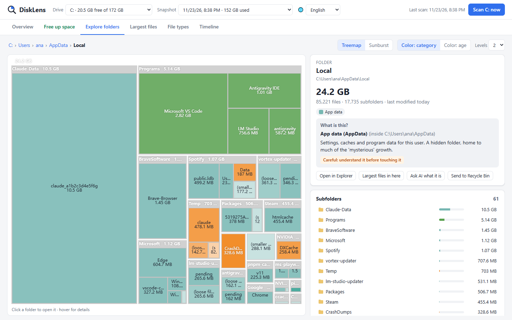

- **Treemap** o **Sunburst**, con navegación: haz clic en una carpeta para entrar. La ruta de arriba permite volver.
- **Color por categoría** o **por antigüedad** (última semana, último mes, últimos 3 meses…), para ver lo nuevo.
- El panel **"¿Qué es esto?"** explica la carpeta, su categoría y el nivel de seguridad para limpiarla.
- Botones **Abrir en el Explorador**, **Archivos más grandes aquí dentro**, **Preguntar a la IA qué es** y **Enviar a la Papelera** (con las mismas protecciones que la pestaña de limpieza).

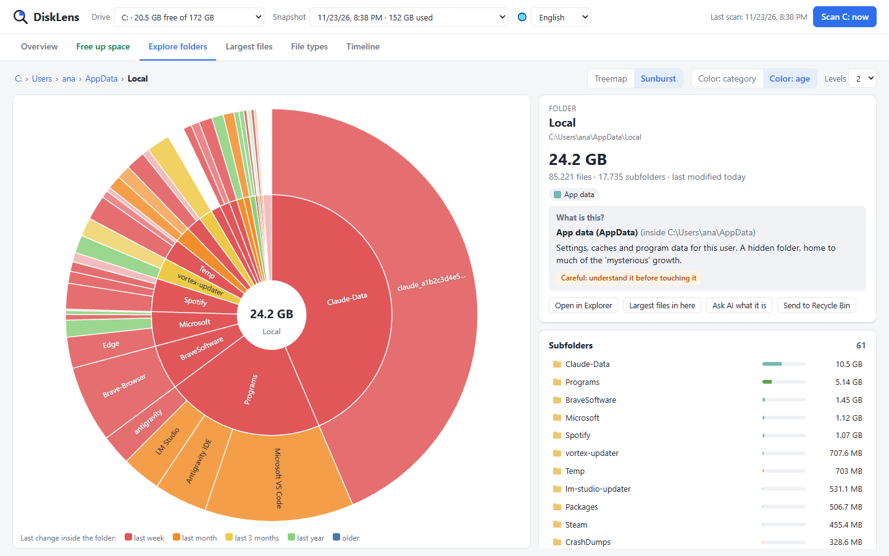

La base de conocimiento (`rules.json`) tiene más de 110 reglas para carpetas conocidas de Windows, programas, juegos y herramientas de desarrollo.

### Archivos más grandes y tipos de archivo

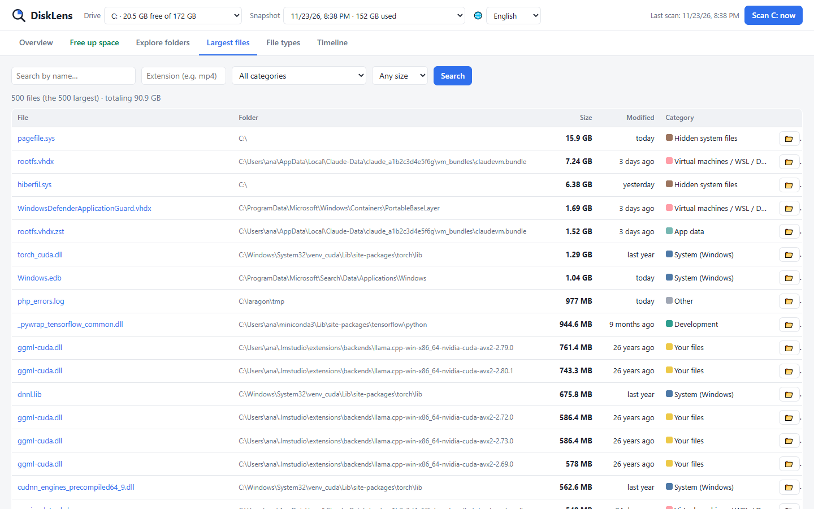

Búsqueda por nombre, extensión, categoría, tamaño mínimo y carpeta. Cada fila abre el archivo seleccionado en el Explorador.

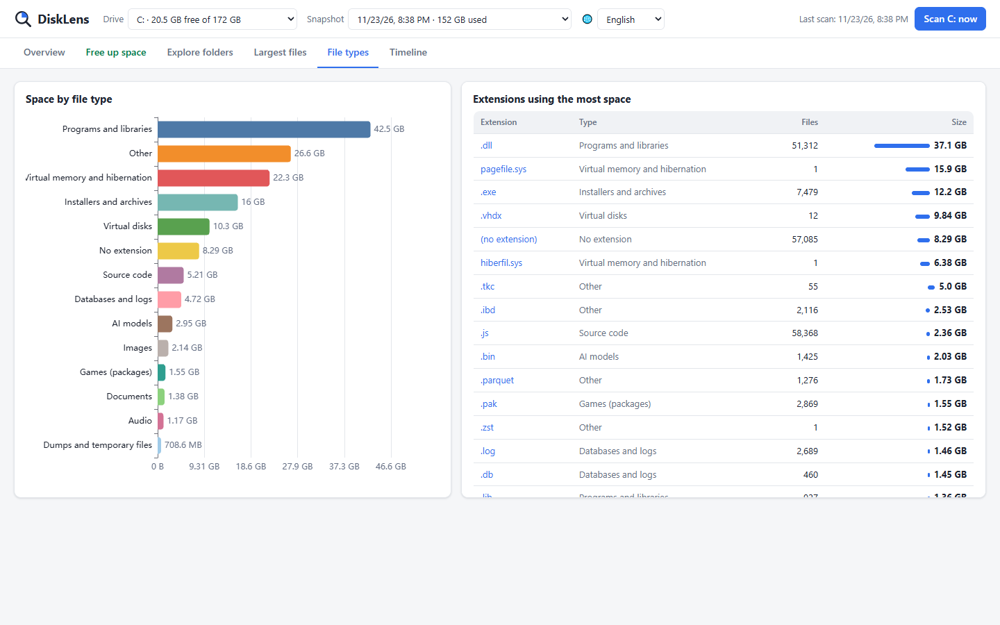

Espacio por familia de archivos (programas, instaladores, discos virtuales, modelos de IA, imágenes…) y por extensión.

### Línea de tiempo

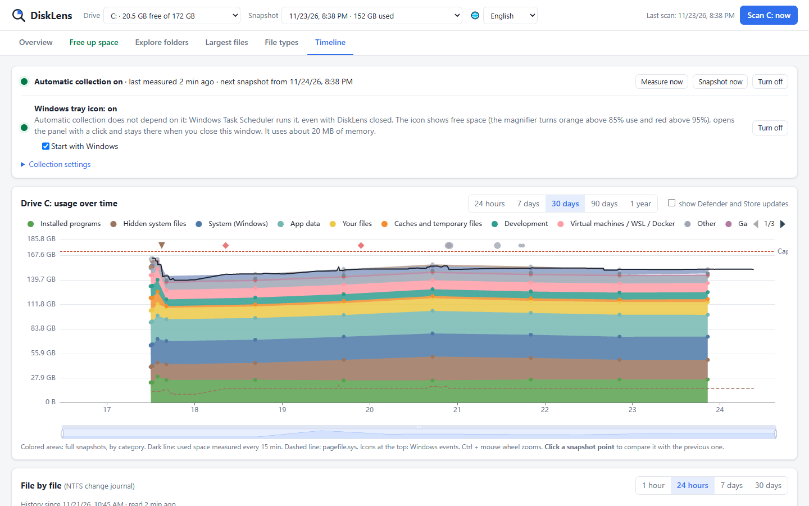

Activa la **recopilación automática**: una tarea del Programador de tareas de Windows que se ejecuta cada 15 minutos, **incluso con DiskLens cerrado**.

1. **Medición** (unos 2 s): espacio usado y libre de cada disco, pagefile, hiberfil y puntos de restauración.
2. **Eventos de Windows**: actualizaciones, programas instalados y quitados, puntos de restauración, bloqueos.
3. **Instantánea completa** una vez al día, solo cuando el equipo está libre.

**Comparar dos momentos.** Elige dos instantáneas, o haz clic en un punto del gráfico, y DiskLens explica el cambio:

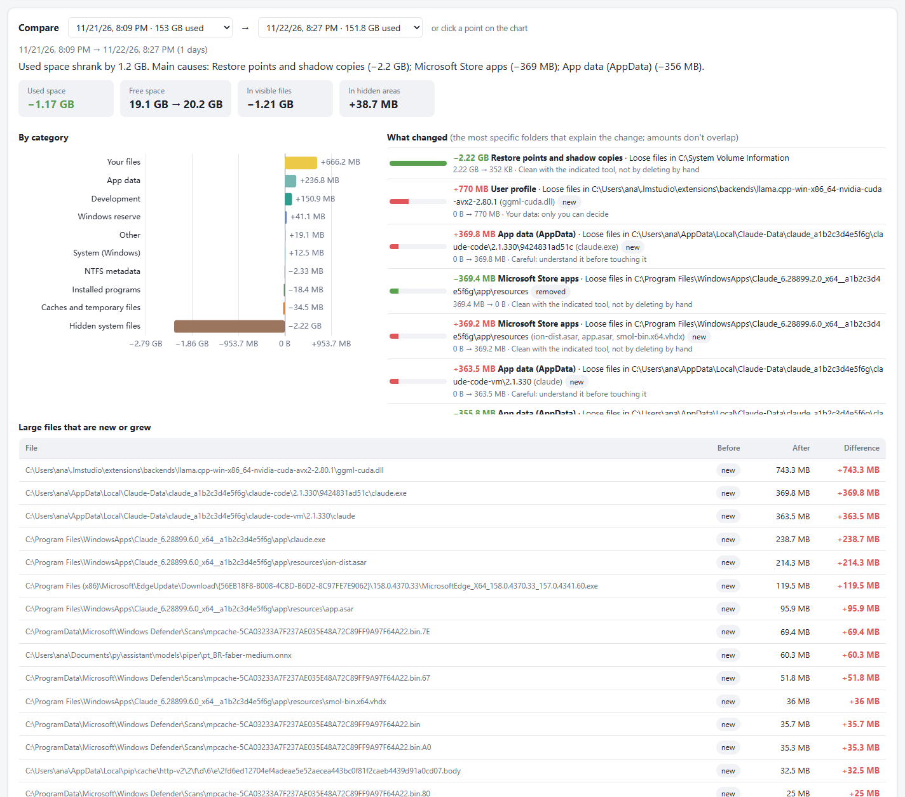

- un **resumen en texto**;
- la variación por categoría y en las áreas ocultas;
- **las carpetas más específicas que explican el cambio**, sin contar lo mismo dos veces;
- los archivos de 10 MB o más que aparecieron o crecieron;
- los eventos de Windows del período y los mayores saltos entre mediciones.

### Archivo por archivo (diario de NTFS)

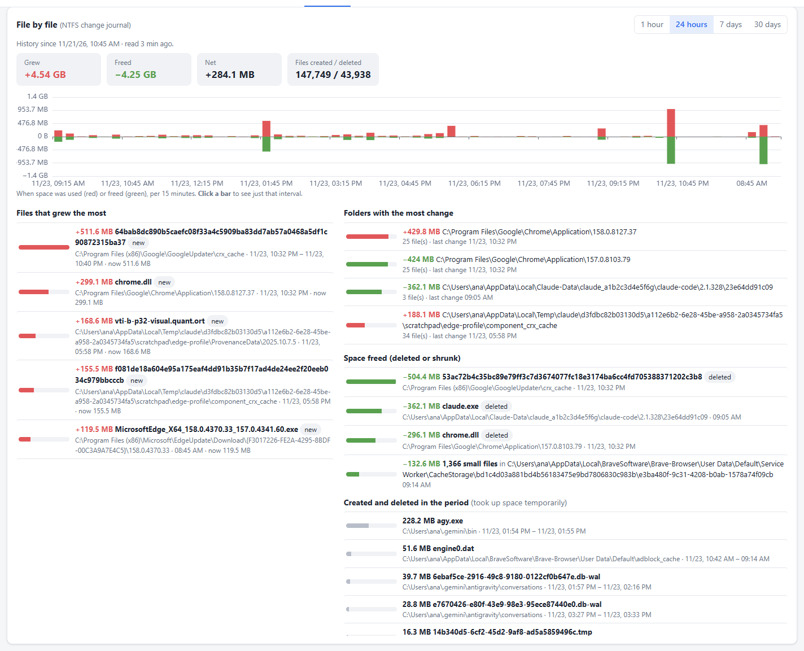

NTFS registra cada archivo creado, ampliado, reducido o borrado. En cada ejecución, el agente lee los registros nuevos, abre cada archivo cambiado por su ID de NTFS y guarda la diferencia de tamaño. La tarjeta muestra cuánto creció y cuánto se liberó, **cuándo** se consumió el espacio (cada 15 minutos), los archivos que más crecieron y los que **ocuparon espacio temporalmente** (creados y borrados en el período, como instaladores y actualizaciones).

Leer el diario requiere administrador. La tarea programada ya se ejecuta así.

### Asistente de IA (cualquier proveedor)

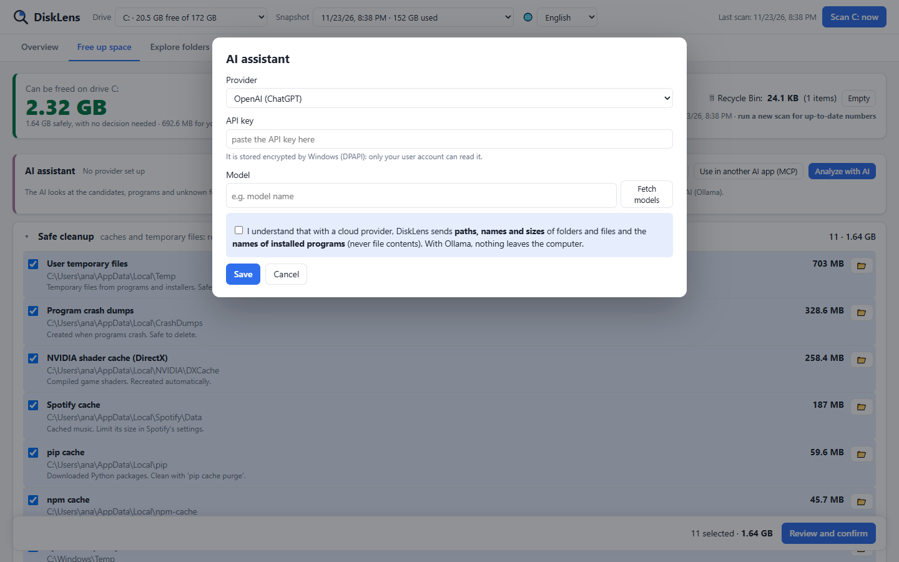

En **Liberar espacio → Asistente de IA → Configurar**, elige el proveedor: OpenAI, Google Gemini, DeepSeek, Anthropic (Claude), Ollama (**local**: nada sale del equipo) o cualquier servicio compatible con la API de OpenAI.

La IA revisa los candidatos, los programas y las carpetas desconocidas y recomienda **borrar / desinstalar / conservar / revisar**, siempre con el motivo:

- solo puede recomendar elementos que DiskLens listó;
- **nunca borra nada por sí sola**: tú confirmas antes de cualquier acción;
- la clave de API se guarda cifrada por Windows (DPAPI);
- responde en el idioma elegido en DiskLens.

### Servidor MCP (úsalo desde otras apps de IA)

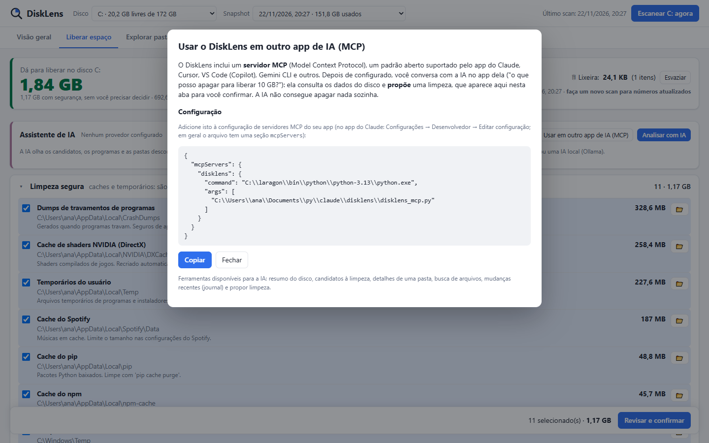

DiskLens incluye un servidor [MCP](https://modelcontextprotocol.io) (Model Context Protocol), hecho solo con la biblioteca estándar de Python. Con él, conversas con la IA en la app que prefieras (la app de Claude, Cursor, VS Code, Gemini CLI y otras):

> "¿Qué puedo borrar para liberar 10 GB?"

Herramientas: `get_disk_overview`, `list_cleanup_candidates`, `get_folder_details`, `search_files`, `get_recent_changes` y `propose_cleanup`, que crea una **propuesta** validada que aparece en la pestaña Liberar espacio para que la confirmes. **No existe ninguna herramienta que borre.** La configuración lista para copiar está en **Liberar espacio → Usar en otra app de IA (MCP)**.

### Icono en la bandeja

  

Opcional y **desactivado por defecto**: actívalo en **Línea de tiempo → Activar icono en la bandeja**. El icono es una lupa sobre un gráfico circular del disco del sistema: **azul**, **naranja** por encima del 85% de uso y **rojo** por encima del 95%. Clic: abre el panel. Clic derecho: espacio libre de cada disco, estado de la recopilación, "Medir ahora", "Iniciar con Windows" y "Salir".

### Idiomas

DiskLens habla **inglés, portugués y español**. Por defecto sigue el idioma de Windows; cámbialo con el selector 🌐 en la parte superior de la ventana. Todo está traducido: la interfaz, las explicaciones de las carpetas, el menú de la bandeja, los mensajes de limpieza y las respuestas de la IA.

### Tema oscuro

Sigue el tema de Windows automáticamente.

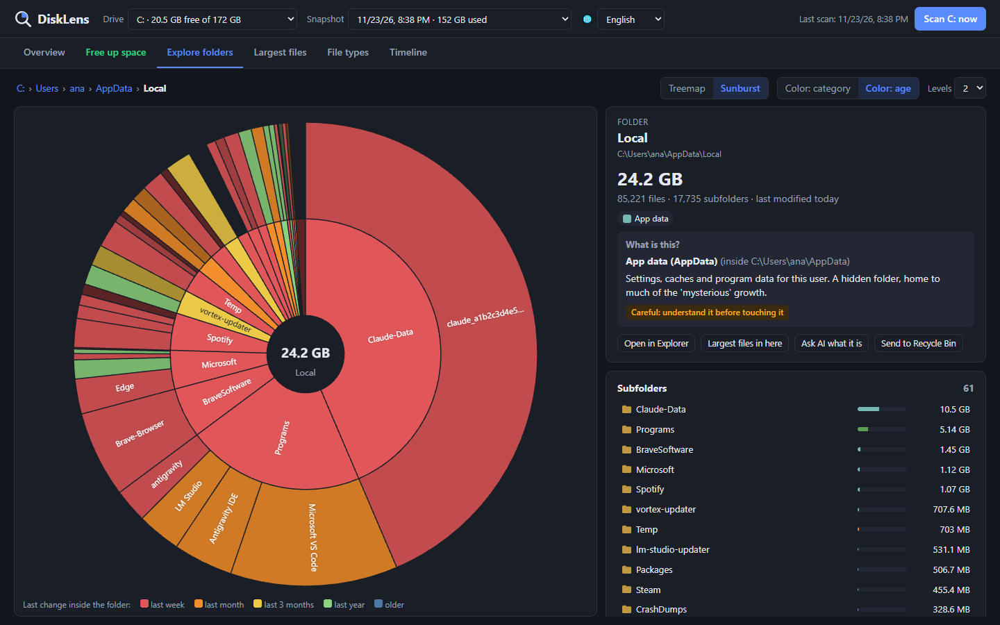

---

## Instalación

### Instalador (recomendado)

1. Descarga **`DiskLens-Setup-<versión>.exe`** de la [última versión](https://github.com/dionedde/disklens/releases/latest).
2. Ejecútalo. Se instala solo para tu usuario (sin contraseña de administrador) e incluye todo lo que necesita, Python incluido: no hay nada más que instalar.
3. Abre **DiskLens** desde el menú Inicio. Usa **DiskLens (administrador)** para leer también las carpetas protegidas.

El instalador aún no tiene firma digital, así que Windows puede mostrar **"Windows protegió su PC"** (SmartScreen). Haz clic en **Más información → Ejecutar de todas formas**.

Para quitarlo: **Configuración → Aplicaciones → DiskLens → Desinstalar**. Pregunta si también debe borrar el historial y la configuración.

### Desde el código fuente (desarrolladores)

**Requisitos:** Windows 10 u 11 y **Python 3.12 o más reciente** ([python.org](https://www.python.org/downloads/)). La ventana usa Edge WebView2, que ya viene con Windows.

1. Instala Python marcando **"Add python.exe to PATH"**.
2. Descarga el proyecto ([Code → Download ZIP](https://github.com/dionedde/disklens/archive/refs/heads/main.zip)) o clónalo:
   ```bash
   git clone https://github.com/dionedde/disklens.git
   ```
3. Haz doble clic en **`Instalar.bat`**. Crea el entorno `.venv` (unos 20 MB) e instala la única dependencia, `pywebview`.

En la primera ejecución se crea `config.json`, que elige dónde guardar los datos: por defecto `X:\DiskLens\data` en el disco **que no es del sistema** con más espacio libre, o `data\` dentro del proyecto.

## Cómo usarlo

| Para… | Haz |
|---|---|
| Abrirlo | menú Inicio → **DiskLens** (desde el código fuente: **`DiskLens.bat`**) |
| Ver todo, incluso carpetas protegidas (**recomendado**) | menú Inicio → **DiskLens (administrador)** (desde el código fuente: **`DiskLens (administrador).bat`**) |
| Primer escaneo | botón **Escanear C: ahora**: cerca de 1 minuto para ~740 mil archivos |
| Liberar espacio ya | pestaña **Liberar espacio**, revisa los elementos marcados, **Revisar y confirmar** |
| Descubrir por qué desapareció el espacio | pestaña **Línea de tiempo**, **Activar recopilación automática**. Tras unos días, usa **Comparar** y la tarjeta **Archivo por archivo** |
| Usar la IA | **Liberar espacio → Asistente de IA → Configurar** |
| Cambiar el idioma | selector 🌐 en la parte superior |

Para desactivar la recopilación automática, usa el botón **Desactivar** en la Línea de tiempo (o `schtasks /Delete /TN "DiskLens\Agente" /F` como administrador).

---

## Seguridad: lo que DiskLens nunca hace

Las protecciones se comprueban **al listar, al proponer y otra vez justo antes de ejecutar**, y valen para la interfaz, la IA y MCP:

- nunca borra la raíz del disco, `Windows`, `Archivos de programa`, `ProgramData`, carpetas de programas instalados, Python ni los datos del propio DiskLens, pagefile/hiberfil, ni carpetas de perfil completas;
- al vaciar una caché, **nunca sigue junctions ni enlaces** fuera de ella;
- las áreas marcadas "usa la herramienta" (WinSxS, Windows Update…) solo se limpian con la herramienta oficial;
- los archivos personales van **a la Papelera**;
- los programas solo se quitan con su **desinstalador oficial**;
- todo queda registrado en el historial.

## No estorba al usar el PC

El escaneo corre en un proceso aparte con la **prioridad mínima** de CPU, disco y memoria, y **se pausa solo** cuando un juego o app está en **pantalla completa**, cuando otros programas usan **más del 60% de la CPU** de forma constante o cuando la memoria pasa del **90%**. La instantánea automática también se **pospone** en esos casos y cuando el portátil está con batería.

## Privacidad

- Todo se queda en tu equipo. DiskLens no tiene servidor, cuenta ni telemetría.
- La interfaz se sirve en `127.0.0.1`, protegida por token.
- La IA solo se usa si la configuras. En ese caso recibe **rutas, nombres y tamaños** de carpetas y archivos y los nombres de los programas, **nunca el contenido de los archivos**. Con Ollama, nada sale del equipo.

## Cómo funciona por dentro

Python con solo la biblioteca estándar (más `pywebview` para la ventana). Consulta la [versión en inglés](README.md#how-it-works-inside) para la descripción de cada módulo. Los textos de origen están en portugués y `disklens/locales.json` los traduce al inglés y al español; `python tools/i18n_keys.py` señala lo que falte.

## Pruebas

```bash
.venv\Scripts\python.exe -m unittest discover -s tests -v
```

## Preguntas frecuentes

**¿Tengo que dejar DiskLens abierto para que funcione la recopilación?**
No. La ejecuta el Programador de tareas de Windows. El icono en la bandeja es opcional.

**Borré archivos y el espacio libre no cambió. ¿Y ahora?**
Los archivos personales van a la Papelera. DiskLens te avisa y ofrece el botón **Vaciar la Papelera**.

**El escaneo cuenta más o menos espacio que Windows.**
La diferencia se explica en la tarjeta "Espacio que ninguna carpeta muestra". Sin administrador, algunas carpetas protegidas no se pueden leer.

---

## Apoya el proyecto

DiskLens es gratuito, sin anuncios y de código abierto. Si te ayudó a recuperar espacio, puedes apoyar su desarrollo:

- **[GitHub Sponsors](https://github.com/sponsors/dionedde)**: con tarjeta, desde cualquier país, una vez o cada mes. GitHub no se queda con nada.
- **Pix** (Brasil, cualquier importe): [abre la página de Pix](https://nubank.com.br/cobrar/vvdk8/6b05a2e8-7101-4702-bfc5-e8e9fb8f7861) o usa el botón **♥ Apoyar** en la parte superior de la app, que muestra el código QR.

---

## Licencia

Distribuido bajo la licencia [Apache 2.0](LICENSE).

<sub>Las capturas usan datos reales de un PC, con el nombre del usuario y de carpetas personales cambiados por nombres genéricos.</sub>
