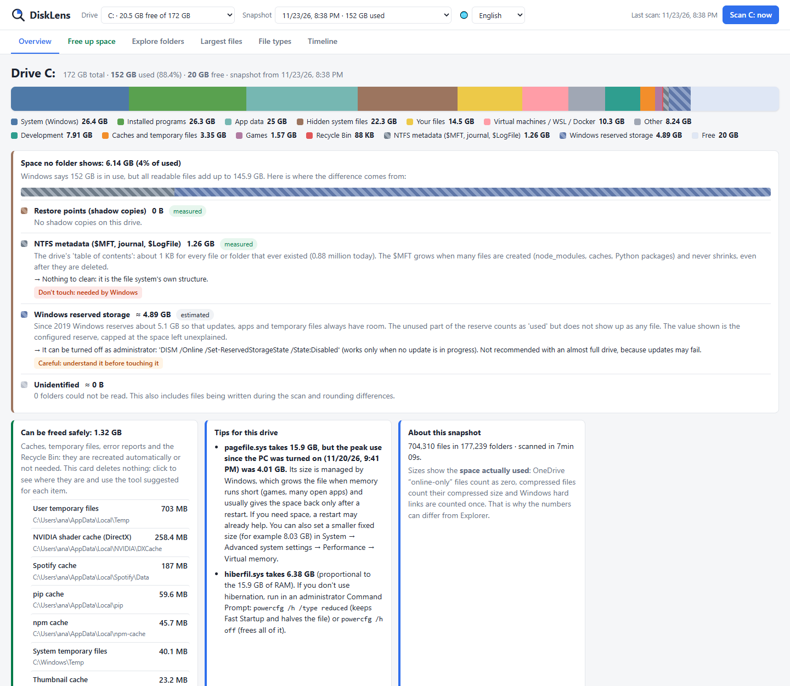
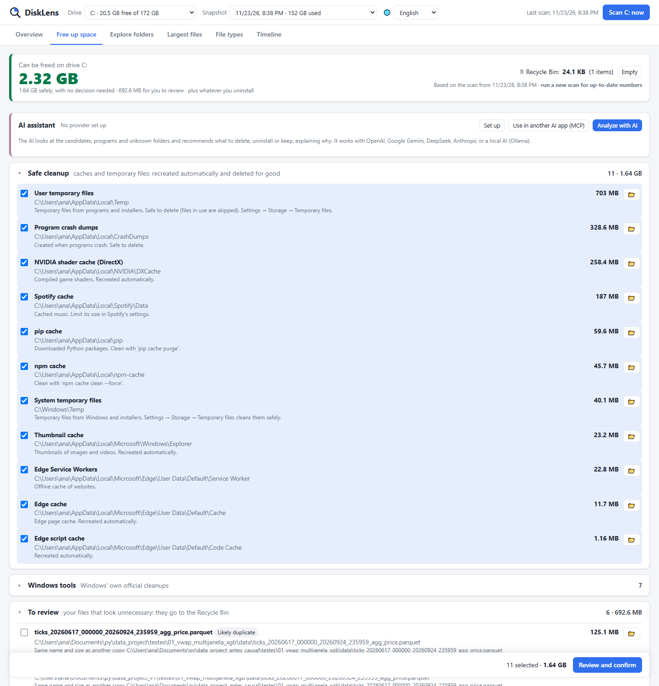
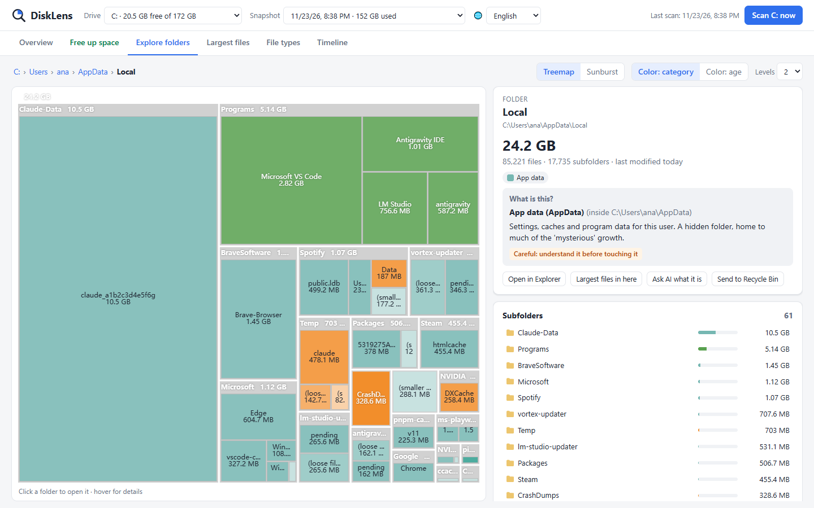
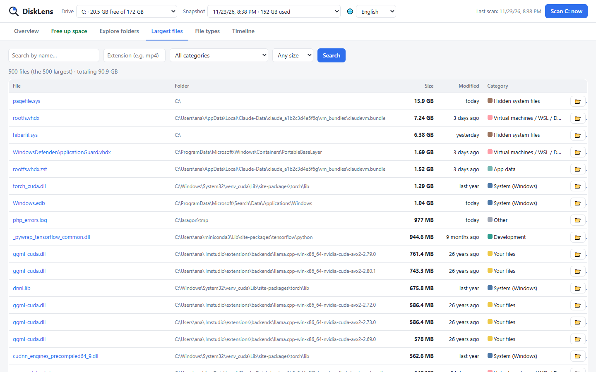
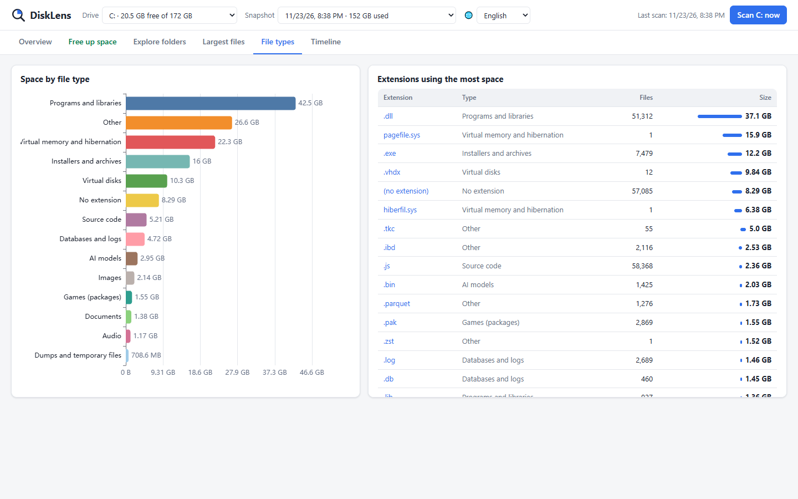
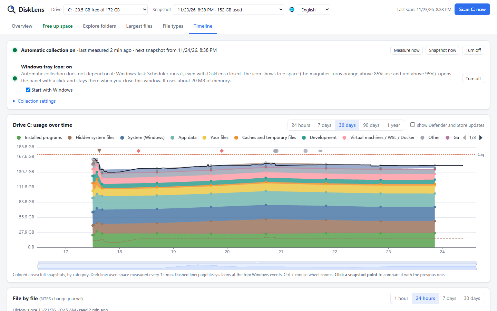
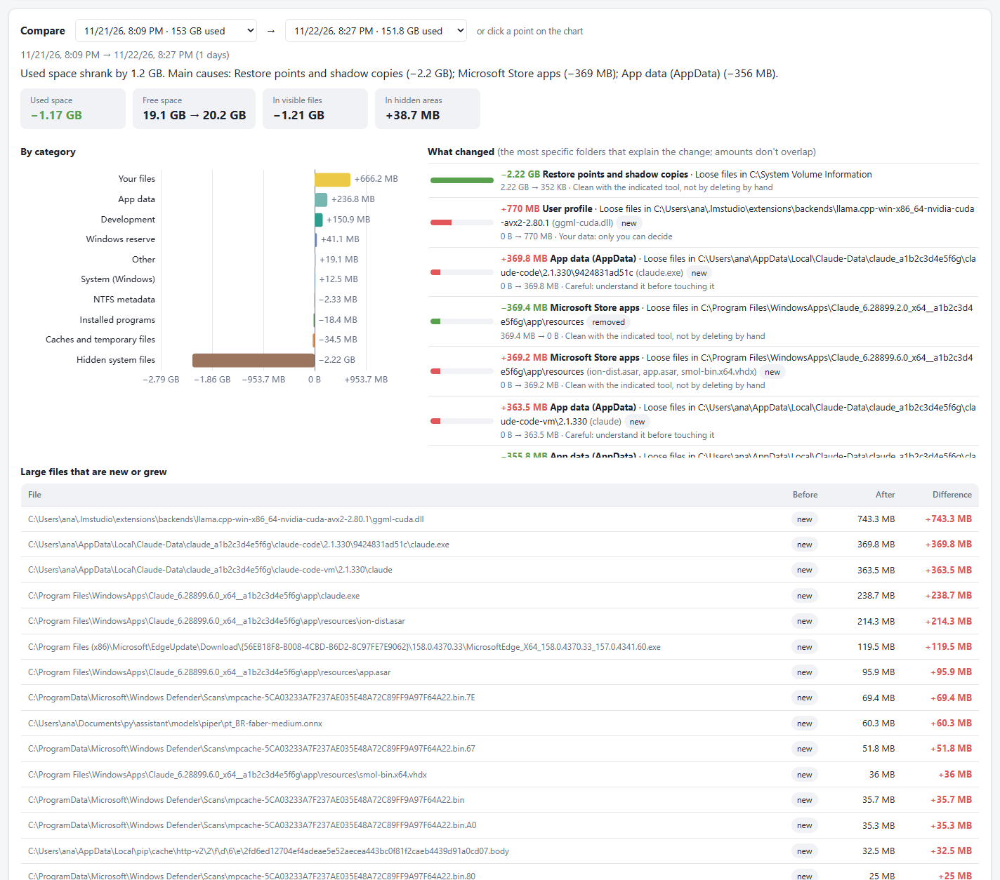
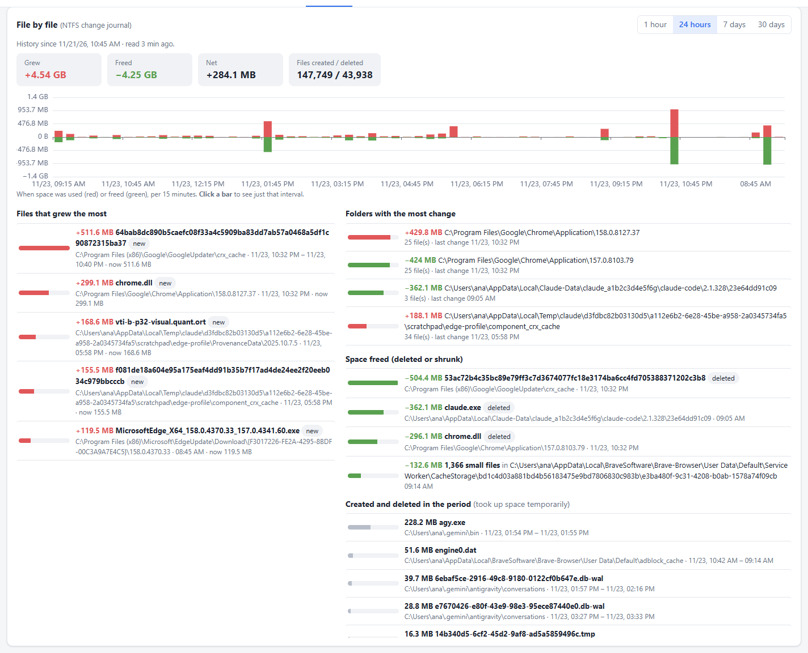
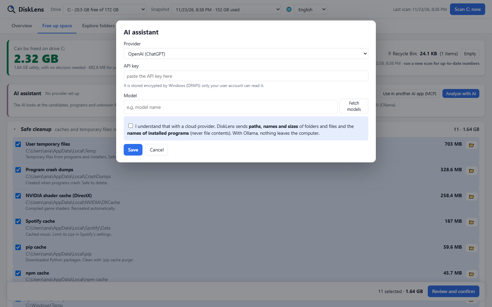
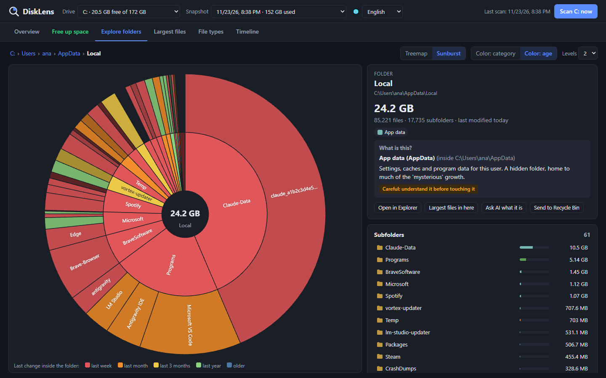

<p align="center">
  
</p>

<h1 align="center">DiskLens</h1>

<p align="center">
  <b>Understand what fills your Windows disk, and why free space disappears.</b><br>
  From the big picture (categories) down to single files, with a timeline, safe cleanup and an AI assistant.
</p>

<p align="center">
  <b>English</b> · <a href="README.pt-BR.md">Português</a> · <a href="README.es.md">Español</a>
</p>

<p align="center">
  
  
  
  
  
</p>



---

## Why DiskLens exists

One day your disk has 20 GB free. A few days later it has 10 GB, and you didn't install anything. Windows tools show *how much* is used, but not **what**, nor **when** it changed.

DiskLens answers three questions:

1. **What is on the disk right now?** Every folder and file, grouped into categories that make sense (system, programs, caches, virtual machines, your files…), each with a plain-language explanation and how safe it is to clean.
2. **What changed, and when?** It measures the disk every 15 minutes, takes a full snapshot once a day and reads the NTFS change journal. So it shows **which file** grew, in **which 15-minute window**.
3. **What can I delete without breaking anything?** A cleanup tab separates what is safe (caches and temporary files), what only you can decide (personal files, which go to the Recycle Bin) and what must go through the official uninstaller. An AI assistant, from any provider, helps you decide.

It also shows the space that **no folder shows**: restore points, Windows reserved storage, NTFS metadata, pagefile and hiberfil.

---

## Contents

- [Features](#features)
  - [Overview and hidden space](#overview-and-hidden-space)
  - [Free up space](#free-up-space)
  - [Explore folders](#explore-folders)
  - [Largest files and file types](#largest-files-and-file-types)
  - [Timeline](#timeline)
  - [File by file (NTFS journal)](#file-by-file-ntfs-journal)
  - [AI assistant (any provider)](#ai-assistant-any-provider)
  - [MCP server](#mcp-server-use-it-from-other-ai-apps)
  - [Tray icon](#tray-icon)
  - [Languages](#languages)
- [Installation](#installation)
- [How to use](#how-to-use)
- [Safety: what DiskLens never does](#safety-what-disklens-never-does)
- [It stays out of your way](#it-stays-out-of-your-way)
- [Privacy](#privacy)
- [How it works inside](#how-it-works-inside)
- [Tests](#tests)
- [FAQ](#faq)
- [Support the project](#support-the-project)

---

## Features

### Overview and hidden space

The disk bar shows each category in its own color. Right below it, the **"Space no folder shows"** card explains the gap between what Windows says is in use and the sum of every readable file:

| Item | How it is measured |
|---|---|
| Restore points (shadow copies) | WMI `Win32_ShadowStorage` and `Get-ComputerRestorePoint` |
| Windows reserved storage | `ReserveManager` registry key |
| NTFS metadata (`$MFT`, journal, `$LogFile`) | `FSCTL_GET_NTFS_VOLUME_DATA` and `FSCTL_QUERY_USN_JOURNAL` |
| Protected folders | read as administrator with `SeBackupPrivilege` (read-only) |
| pagefile.sys / hiberfil.sys | WMI `Win32_PageFileUsage` and power settings |

Each item says whether its value was **measured** or **estimated**, what it is and what you can do about it. Tips for the drive show up too (for example: "pagefile.sys takes 15.9 GB, but the peak use since the PC was turned on was 4.01 GB").

### Free up space



The tab built for **acting**, without needing to understand the details of the other tabs:

| Section | What it shows | How it deletes |
|---|---|---|
| **Safe cleanup** | caches and temporary files: GPU shaders, Spotify, npm, pip, uv, browsers, crash dumps, Temp… | permanently. They are recreated automatically, and files in use are skipped |
| **Windows tools** | Windows Update cache, component cleanup (DISM), Delivery Optimization, old restore points, hibernation, emptying the Recycle Bin | through the official Windows tools |
| **To review** | old installers in Downloads, large files untouched for a long time, likely duplicates, builds and dependencies of idle projects | **to the Recycle Bin** (can be undone) |
| **Installed programs** | every program, with measured size, drive and dates; dependencies (runtimes, drivers) are flagged | through the program's **official uninstaller** |
| **Large unknown folders** | big folders that no rule knows | an "Ask AI" button |

Before running, a grouped summary asks for confirmation. Afterwards, the result makes clear how much was really freed and how much **went to the Recycle Bin**. That space only comes back once the Recycle Bin is emptied, and there is a button for that right there. So you are never left wondering why you deleted files and free space didn't change.

### Explore folders



- **Treemap** or **Sunburst**, with drill-down: click a folder to enter it. The path at the top takes you back.
- **Color by category** or **color by age** (last week, last month, last 3 months…), to see what is new.
- The **"What is this?"** panel explains the folder and gives its category and how safe it is to clean ("Safe to clean", "Clean with the indicated tool", "Careful: understand it before touching it", "Don't touch").
- **Open in Explorer**, **Largest files in here**, **Ask AI what it is** and **Send to Recycle Bin** buttons (with the same protections as the cleanup tab).


The knowledge base (`rules.json`) has more than 110 rules for well-known folders of Windows, programs, games and development tools.

### Largest files and file types



Search by name, extension, category, minimum size and folder. Each row opens the file, selected, in Explorer.



Space by file family (programs, installers, virtual disks, AI models, images…) and by extension. Special files such as `pagefile.sys` and `hiberfil.sys` are shown separately.

### Timeline



Turn on **automatic collection**: a Windows Task Scheduler task that runs every 15 minutes, **even with DiskLens closed**.

1. **Measurement** (about 2 s): used and free space of each drive, pagefile, hiberfil and restore points.
2. **Windows events**: updates, programs installed and removed, restore points, crashes.
3. **Full snapshot** once a day, only when the computer is idle (see [It stays out of your way](#it-stays-out-of-your-way)).

The chart stacks usage by category, with the line of 15-minute measurements, the pagefile and the events. The 24 hours, 7 days, 30 days, 90 days and 1 year buttons pick the period, and Ctrl + mouse wheel zooms.

**Compare two moments.** Pick two snapshots, or click a point on the chart, and DiskLens explains the change:



- a **text summary** ("Used space shrank by 1.2 GB. Main causes: …");
- the change by category and in the hidden areas;
- **the most specific folders that explain the change**, without counting the same thing twice;
- files of 10 MB or more that appeared or grew;
- Windows events in the period and the biggest jumps between measurements.

### File by file (NTFS journal)



NTFS records every file created, grown, shrunk or deleted. On each run, the agent reads the new records, opens each changed file by its NTFS ID and stores the size difference. The card shows:

- how much grew and how much was freed in the last hour, 24 hours, 7 or 30 days;
- **when** space was consumed, every 15 minutes (click a bar to filter that window);
- the files that grew the most, the folders with the most change and the space freed;
- the files that **took up space temporarily**: created and deleted within the period, such as installers and updates. That is exactly the kind of thing that makes free space "blink".

Reading the journal requires administrator rights. The scheduled task already runs that way, without asking for anything day to day.

### AI assistant (any provider)



In **Free up space → AI assistant → Set up**, pick a provider:

| Provider | Note |
|---|---|
| OpenAI | `/chat/completions` API |
| Google Gemini | OpenAI-compatible endpoint |
| DeepSeek | `api.deepseek.com` |
| Anthropic (Claude) | `/messages` API |
| Ollama | **local**: nothing leaves your computer |
| Custom | any service compatible with the OpenAI API |

The "Fetch models" button lists the models on your account. The AI looks at the candidates, the programs and the unknown folders and recommends **delete / uninstall / keep / review**, always with a reason:

- it can only recommend items DiskLens listed: made-up ids are discarded;
- **it never deletes anything by itself**: you confirm before any action;
- the API key is encrypted by Windows (DPAPI), and only your user account can read it;
- it answers in the language you picked for DiskLens.

### MCP server (use it from other AI apps)


DiskLens includes an [MCP](https://modelcontextprotocol.io) (Model Context Protocol) server, built only with the Python standard library. With it, you chat with the AI in the app you prefer (the Claude app, Cursor, VS Code, Gemini CLI and others):

> "What can I delete to free 10 GB?"

| Tool | What it does |
|---|---|
| `get_disk_overview` | usage by category, hidden space and Recycle Bin |
| `list_cleanup_candidates` | safe caches, tools, items to review, programs and unknown folders |
| `get_folder_details` | size, explanation, subfolders and largest files of a folder |
| `search_files` | search by name, extension, age, size or folder |
| `get_recent_changes` | what grew in the last N hours, file by file |
| `propose_cleanup` | creates a validated **proposal** that shows up in the Free up space tab for you to confirm |

**There is no tool that deletes.** The ready-to-copy configuration is in **Free up space → Use in another AI app (MCP)**.

### Tray icon

  

Optional and **off by default**: turn it on in **Timeline → Turn on tray icon**. The icon is a magnifying glass over a pie chart of the system drive. The slice shows used space: **blue**, **orange** above 85% and **red** above 95%.

- **Click:** opens the panel. **Right-click:** free space of each drive, collection status, "Measure now", "Start with Windows" and "Quit".
- Closing the panel leaves the icon in the tray. The icon is a light process (about 20 MB), and the window, which uses WebView2, is open only when you want it.
- "Start with Windows" does not need administrator rights.

### Languages

DiskLens speaks **English, Portuguese and Spanish**. It follows the Windows display language by default; change it with the 🌐 selector at the top of the window. Everything is translated: the interface, folder explanations, tray menu, cleanup messages and the AI's answers.

### Dark theme

Follows the Windows theme automatically.



---

## Installation

### Installer (recommended)

1. Download **`DiskLens-Setup-<version>.exe`** from the [latest release](https://github.com/dionedde/disklens/releases/latest).
2. Run it. It installs for your user only (no administrator password) and brings everything it needs, Python included: there is nothing else to install.
3. Open **DiskLens** from the Start menu. Use **DiskLens (administrator)** to also read protected folders.

The installer is not digitally signed yet, so Windows may show **"Windows protected your PC"** (SmartScreen). Click **More info → Run anyway**.

To remove it: **Settings → Apps → DiskLens → Uninstall**. It asks whether to also delete the history and settings.

### From the source code (developers)

**Requirements:** Windows 10 or 11 and **Python 3.12 or newer** ([python.org](https://www.python.org/downloads/)). The window uses Edge WebView2, which already ships with Windows.

1. Install Python, checking **"Add python.exe to PATH"**.
2. Download the project ([Code → Download ZIP](https://github.com/dionedde/disklens/archive/refs/heads/main.zip)) or clone it:
   ```bash
   git clone https://github.com/dionedde/disklens.git
   ```
3. Double-click **`Instalar.bat`**. It creates the `.venv` environment (about 20 MB) and installs the only dependency, `pywebview`.

No compiler or anything heavy: the scanner, the agent, the AI and the MCP server use only the Python standard library.

On first run, `config.json` is created and picks where to keep the data: by default `X:\DiskLens\data` on the **non-system** drive with the most free space (so it doesn't fill C:), or `data\` inside the project.

## How to use

| To… | Do |
|---|---|
| Open it | Start menu → **DiskLens** (from the source code: **`DiskLens.bat`**) |
| See everything, including protected folders (**recommended**) | Start menu → **DiskLens (administrator)** (from the source code: **`DiskLens (administrador).bat`**) |
| First scan | **Scan C: now** button: about 1 minute for ~740 thousand files |
| Free space right away | **Free up space** tab, check the selected items, **Review and confirm** |
| Find out why space disappeared | **Timeline** tab, **Turn on automatic collection**. After a few days, use **Compare** and the **File by file** card |
| Learn what a folder is | **Explore folders** tab, click it and read "What is this?", or use **Ask AI what it is** |
| Use the AI | **Free up space → AI assistant → Set up** |
| Use it from the Claude app, Cursor etc. | **Free up space → Use in another AI app (MCP)** and copy the configuration |
| Change the language | 🌐 selector at the top |

Only one panel opens at a time: opening it again brings the existing window to the front.

To turn off automatic collection, use the **Turn off** button in the Timeline (or `schtasks /Delete /TN "DiskLens\Agente" /F` as administrator).

---

## Safety: what DiskLens never does

The protections (`cleaner.protection_reason`) are checked **when listing, when proposing and again right before running**. They apply to the interface, the AI and MCP:

- it never deletes the drive root, `Windows`, `Program Files`, `ProgramData`, folders of installed programs (read from the registry), Python and DiskLens's own data, pagefile/hiberfil, or whole profile folders;
- when emptying a cache, it **never follows junctions or links** out of it;
- areas marked "use the tool" (WinSxS, Windows Update…) are only cleaned by the official tool;
- personal files go **to the Recycle Bin**, never deleted directly;
- programs are only removed by their **official uninstaller**;
- everything is recorded in the history (`cleanup_log`).

A request to delete something protected is refused **even when it comes straight through the local API**, and the API only accepts calls carrying a token generated on each run.

## It stays out of your way

The scan runs in a separate process at the **lowest** CPU, disk and memory priority (`PROCESS_MODE_BACKGROUND_BEGIN`), and **pauses by itself** when:

- a game or app is in **full screen**;
- other programs keep the **CPU above 60%**;
- memory goes over **90%**.

It resumes after 30 s of calm. The automatic snapshot is also **postponed** in those cases and when the laptop is on battery, retrying after 30 min, 1 h, 2 h and at most 4 h. The limits can be set in the Timeline tab.

## Privacy

- Everything stays on your computer. DiskLens has no server, no account and no telemetry.
- The interface is served on `127.0.0.1`, protected by a token.
- The AI is used only if you set it up. In that case it receives **paths, names and sizes** of folders and files and the names of programs, **never file contents**. A notice asks for your consent before the first use. With Ollama, nothing leaves your computer.

---

## How it works inside

```
disklens/
  scanner.py     multithreaded scan (os.scandir + ctypes): real size on disk (clusters,
                 compressed, sparse, WOF), hard links counted once, OneDrive placeholders = 0
  loadguard.py   pauses and resumes according to the PC's load
  probes.py      measures the hidden space and reconciles it with the scan
  agent.py       collection every 15 min: measurements, events, journal, snapshot with load checks
  tasks.py       registers/removes the Task Scheduler task
  usn.py         reads the NTFS journal (FSCTL_READ_USN_JOURNAL) and measures each changed file
  diff.py        compares two snapshots and explains what changed, without overlap
  rules.json     knowledge base: folder -> category, explanation, safety
  cleaner.py     protections, emptying caches, Recycle Bin (SHFileOperation), Windows tools
  candidates.py  cleanup candidates and installed programs (Windows registry)
  proposals.py   AI/MCP proposals and running the confirmed actions
  ai.py          multi-provider assistant (standard library only; key stored with DPAPI)
  mcp_server.py  stdio MCP server (entry point: disklens_mcp.py)
  server.py      local API (127.0.0.1, with token)
  app.py         native window (pywebview / Edge WebView2)
  tray.py        tray icon (ctypes / Win32)
  instance.py    single instance, panel and "Start with Windows"
  icon.py        draws the icon in code (ICO/PNG, no images or Pillow)
  i18n.py        languages (catalog in locales.json)
  web/           interface (HTML/CSS/JS + local ECharts)
```

**Data** (in `data_dir`):

- `index.db`: snapshots, measurements, events and cleanup history.
- `snap_<id>.db`: one snapshot. The latest keeps every file; older ones keep folders and files of 10 MB or more. After 90 days, one snapshot per week is kept.
- `usn.db`: changes read from the journal.

**Measurement details:**

- Each file's size is the **space allocated on disk**, rounded to the cluster. Compressed, sparse and WOF files are measured with `GetCompressedFileSizeW`, and cloud files (OneDrive) count as 0.
- Files with **hard links** (WinSxS ↔ System32, Edge ↔ EdgeWebView, Conda packages…) are counted only once.
- Junctions and symbolic links are never followed.

**Translations:** the source strings are Portuguese, and `disklens/locales.json` maps each one to English and Spanish. `python tools/i18n_keys.py` lists every translatable string and reports anything missing; a test fails if the catalog is incomplete.

## Building the installer

```bash
.venv\Scripts\python.exe tools\build_installer.py
```

It needs [Inno Setup 6](https://jrsoftware.org/isinfo.php) and the official *Windows embeddable package (64-bit)* of Python, same 3.x as `.venv`, saved in `build\cache\` (check its SHA-256 on the python.org release page). The result is `dist\DiskLens-Setup-<version>.exe`: the app with its own Python in `runtime\`, installed per user in `%LOCALAPPDATA%\Programs\DiskLens`.

## Tests

Tests don't need administrator rights. They use throwaway folders, a simulated journal and a fake AI server, so no real service is called:

```bash
.venv\Scripts\python.exe -m unittest discover -s tests -v
```

There is also a real journal self-test, which requires administrator rights: `python -m disklens.usn output.json`.

## FAQ

**Do I need to keep DiskLens open for collection to work?**
No. Windows Task Scheduler runs the collection. The tray icon is optional.

**Why does "Free up space" show less than I expected?**
It only lists what can be deleted without affecting your programs or Windows. Personal files appear under "To review", and the rest is your call, which the AI can help with.

**I deleted files and free space didn't change. Now what?**
Personal files go to the Recycle Bin. DiskLens tells you and offers an **Empty the Recycle Bin** button.

**The scan counts more or less space than Windows shows.**
The difference is explained in the "Space no folder shows" card. Without administrator rights, some protected folders can't be read and land in "Unidentified".

**Does it work on other drives?**
Yes: pick the drive at the top. Automatic collection can include other drives in its settings.

---

## Support the project

DiskLens is free, ad-free and open source. If it helped you get space back, you can support its development:

- **[GitHub Sponsors](https://github.com/sponsors/dionedde)**: by card, from any country, once or monthly. GitHub takes no cut.
- **Pix** (Brazil, any amount): [open the Pix page](https://nubank.com.br/cobrar/vvdk8/6b05a2e8-7101-4702-bfc5-e8e9fb8f7861), or use the **♥ Support** button at the top of the app, which shows the QR Code.

---

## License

Distributed under the [Apache 2.0](LICENSE) license.

<sub>The screenshots use real data from a PC, with the user name and personal folder names replaced by generic ones.</sub>
