<p align="center">
  
</p>

<h1 align="center">DiskLens</h1>

<p align="center">
  <b>Entenda o que ocupa o seu disco no Windows, e por que o espaço livre some.</b><br>
  Do macro (categorias) ao micro (arquivo a arquivo), com linha do tempo, limpeza segura e assistente de IA.
</p>

<p align="center">
  
  
  
  
</p>

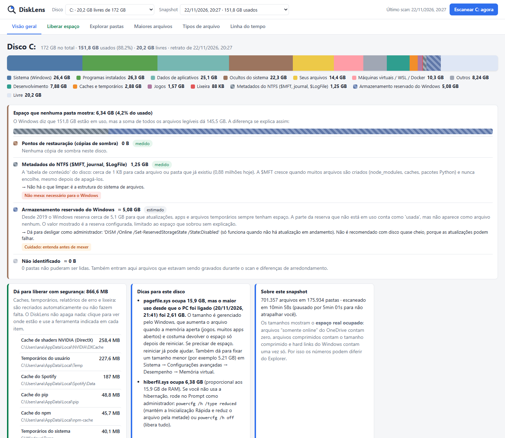

---

## Por que o DiskLens existe

Um dia o disco tem 20 GB livres. Alguns dias depois, tem 10 GB, e você não instalou nada. As ferramentas do Windows mostram *quanto* está ocupado, mas não **o quê**, nem **quando** mudou.

O DiskLens responde a três perguntas:

1. **O que ocupa o disco agora?** Cada pasta e cada arquivo, agrupados em categorias que fazem sentido (sistema, programas, caches, máquinas virtuais, seus arquivos…), cada uma com uma explicação em português e com o nível de segurança para limpar.
2. **O que mudou, e quando?** Ele mede o disco a cada 15 minutos, faz um retrato completo por dia e lê o journal do NTFS. Assim mostra **qual arquivo** cresceu, em **qual intervalo de 15 minutos**.
3. **O que dá para apagar sem quebrar nada?** Uma aba de limpeza separa o que é seguro (caches e temporários), o que só você pode decidir (arquivos pessoais, que vão para a Lixeira) e o que só sai pelo desinstalador oficial. Um assistente de IA, de qualquer provedor, ajuda a decidir.

Ele também mostra o espaço que **nenhuma pasta mostra**: pontos de restauração, armazenamento reservado do Windows, metadados do NTFS, pagefile e hiberfil.

---

## Índice

- [Funcionalidades](#funcionalidades)
  - [Visão geral e espaço oculto](#visão-geral-e-espaço-oculto)
  - [Liberar espaço](#liberar-espaço)
  - [Explorar pastas](#explorar-pastas)
  - [Maiores arquivos e tipos de arquivo](#maiores-arquivos-e-tipos-de-arquivo)
  - [Linha do tempo](#linha-do-tempo)
  - [Arquivo a arquivo (journal do NTFS)](#arquivo-a-arquivo-journal-do-ntfs)
  - [Assistente de IA (qualquer provedor)](#assistente-de-ia-qualquer-provedor)
  - [Servidor MCP](#servidor-mcp-usar-a-partir-de-outros-apps-de-ia)
  - [Ícone na bandeja](#ícone-na-bandeja)
- [Instalação](#instalação)
- [Como usar](#como-usar)
- [Segurança: o que o DiskLens nunca faz](#segurança-o-que-o-disklens-nunca-faz)
- [Não atrapalha o uso do PC](#não-atrapalha-o-uso-do-pc)
- [Privacidade](#privacidade)
- [Como funciona por dentro](#como-funciona-por-dentro)
- [Testes](#testes)
- [Perguntas frequentes](#perguntas-frequentes)

---

## Funcionalidades

### Visão geral e espaço oculto

A barra do disco mostra cada categoria com sua cor. Logo abaixo, o card **"Espaço que nenhuma pasta mostra"** explica a diferença entre o que o Windows diz estar em uso e a soma de todos os arquivos legíveis:

| Item | Como é medido |
|---|---|
| Pontos de restauração (cópias de sombra) | WMI `Win32_ShadowStorage` e `Get-ComputerRestorePoint` |
| Armazenamento reservado do Windows | registro `ReserveManager` |
| Metadados do NTFS (`$MFT`, journal, `$LogFile`) | `FSCTL_GET_NTFS_VOLUME_DATA` e `FSCTL_QUERY_USN_JOURNAL` |
| Pastas protegidas | lidas como administrador com `SeBackupPrivilege` (somente leitura) |
| pagefile.sys / hiberfil.sys | WMI `Win32_PageFileUsage` e configuração de energia |

Cada item diz se o valor foi **medido** ou **estimado**, explica o que é e diz o que dá para fazer a respeito. Também aparecem dicas para o disco (por exemplo: "o pagefile ocupa 15,9 GB, mas o maior uso desde que o PC foi ligado foi 2,6 GB").

### Liberar espaço

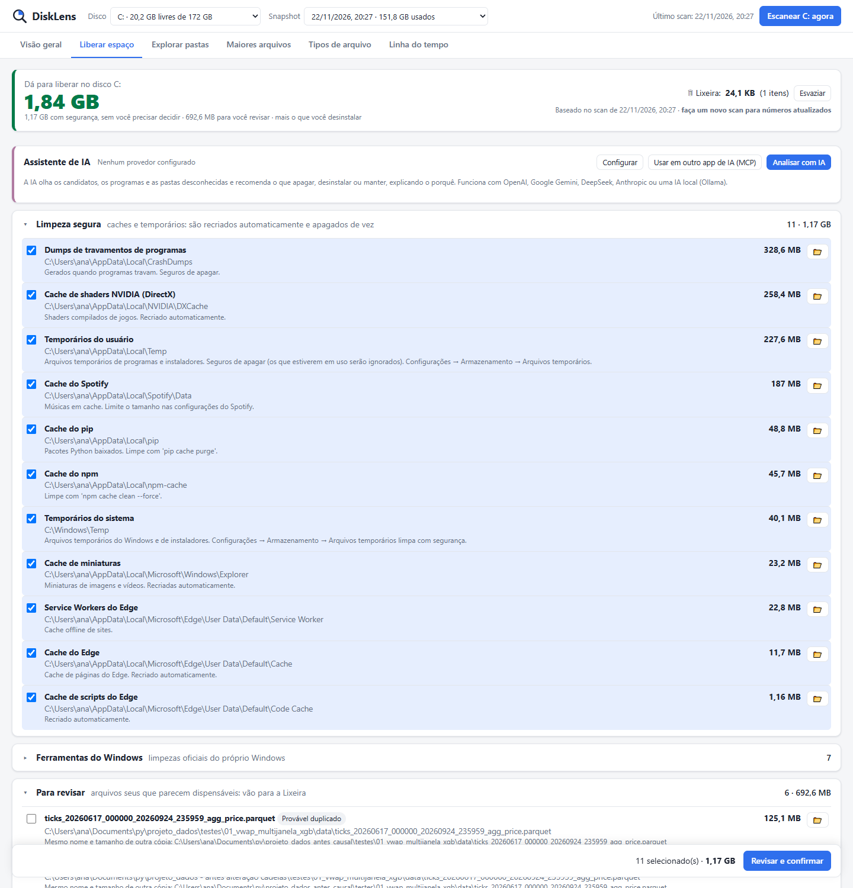

A aba feita para **agir** sem precisar entender os detalhes das outras:

| Seção | O que mostra | Como apaga |
|---|---|---|
| **Limpeza segura** | caches e temporários: shaders de GPU, Spotify, npm, pip, uv, navegadores, dumps de travamento, Temp… | definitivamente. São recriados sozinhos, e arquivos em uso são pulados |
| **Ferramentas do Windows** | cache do Windows Update, limpeza de componentes (DISM), Otimização de Entrega, pontos de restauração antigos, hibernação, esvaziar a Lixeira | pelas ferramentas oficiais do Windows |
| **Para revisar** | instaladores antigos em Downloads, arquivos grandes parados há muito tempo, prováveis duplicados, builds e dependências de projetos parados | **para a Lixeira** (dá para desfazer) |
| **Programas instalados** | todos os programas, com tamanho medido, disco e datas; dependências (runtimes, drivers) marcadas | pelo **desinstalador oficial** do programa |
| **Pastas desconhecidas** | pastas grandes que nenhuma regra conhece | botão "Perguntar à IA" |

Antes de executar, um resumo agrupado pede confirmação. Depois, o resultado deixa claro quanto foi liberado de verdade e quanto **foi para a Lixeira**. Esse espaço só volta quando a Lixeira for esvaziada, e há um botão para isso ali mesmo. Assim você nunca fica sem entender por que apagou arquivos e o espaço livre não mudou.

### Explorar pastas

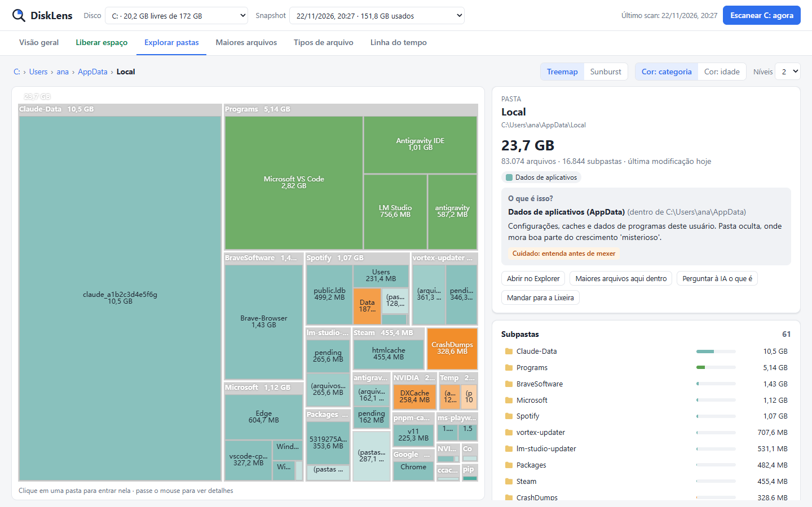

- **Treemap** ou **Sunburst**, com drill-down: clique numa pasta para entrar nela. O caminho no topo permite voltar.
- **Cor por categoria** ou **cor por idade** (última semana, último mês, últimos 3 meses…), para ver o que é novo.
- O painel **"O que é isso?"** explica a pasta, diz a categoria e o nível de segurança para limpar ("Seguro apagar", "Use a ferramenta", "Cuidado: entenda antes de mexer", "Não mexa").
- Botões **Abrir no Explorer**, **Maiores arquivos aqui dentro**, **Perguntar à IA o que é** e **Mandar para a Lixeira** (com as mesmas proteções da aba de limpeza).

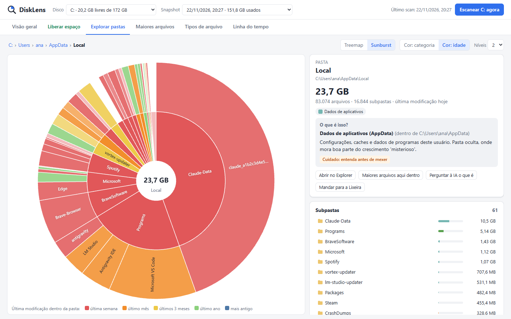

A base de conhecimento (`rules.json`) tem mais de 110 regras para pastas conhecidas do Windows, de programas, de jogos e de ferramentas de desenvolvimento.

### Maiores arquivos e tipos de arquivo

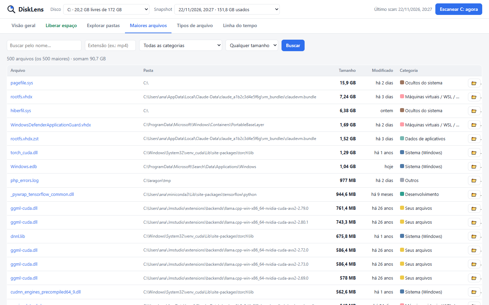

Busca por nome, extensão, categoria, tamanho mínimo e pasta. Cada linha abre o arquivo selecionado no Explorer.

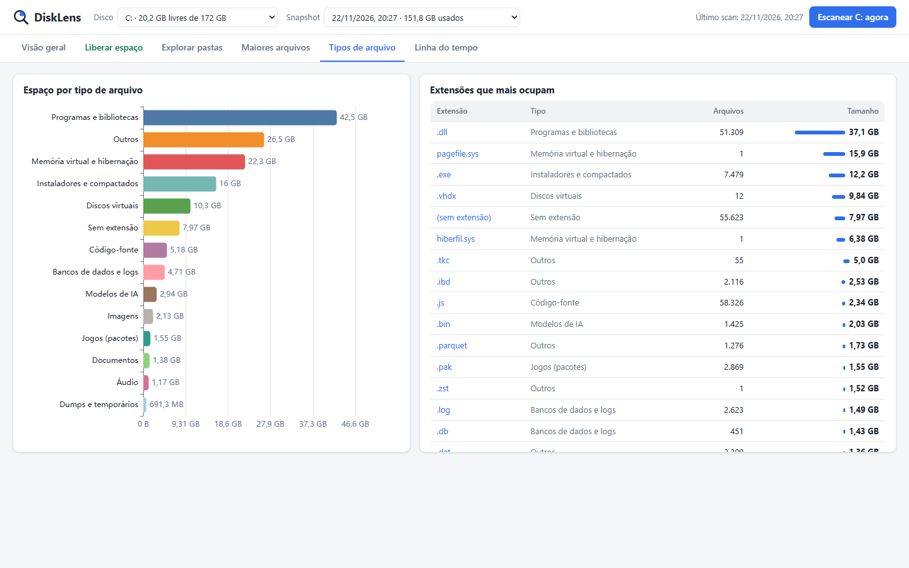

Espaço por família de arquivos (programas, instaladores, discos virtuais, modelos de IA, imagens…) e por extensão. Arquivos especiais como `pagefile.sys` e `hiberfil.sys` aparecem separados.

### Linha do tempo

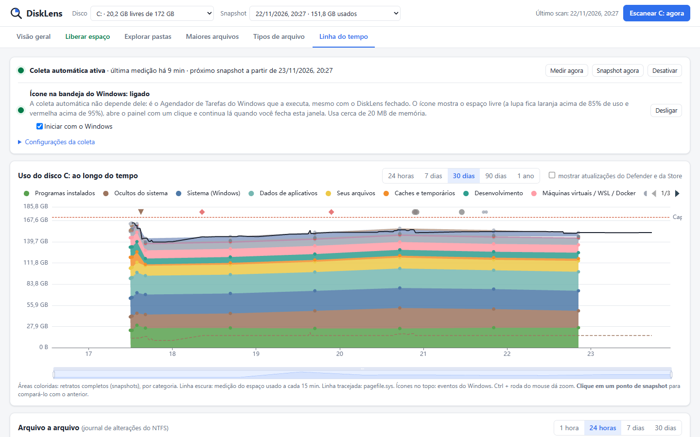

Ative a **coleta automática**: uma tarefa no Agendador de Tarefas do Windows que roda a cada 15 minutos, **mesmo com o DiskLens fechado**.

1. **Medição** (cerca de 2 s): espaço usado e livre de cada disco, pagefile, hiberfil e pontos de restauração.
2. **Eventos do Windows**: atualizações, programas instalados e removidos, pontos de restauração, travamentos.
3. **Retrato completo** (snapshot) uma vez por dia, só quando o computador estiver livre (veja [Não atrapalha o uso do PC](#não-atrapalha-o-uso-do-pc)).

O gráfico empilha o uso por categoria, com a linha das medições de 15 minutos, o pagefile e os eventos. Os botões 24 horas, 7 dias, 30 dias, 90 dias e 1 ano escolhem o período, e Ctrl + roda do mouse dá zoom.

**Comparar dois momentos.** Escolha dois snapshots, ou clique num ponto do gráfico, e o DiskLens explica a mudança:

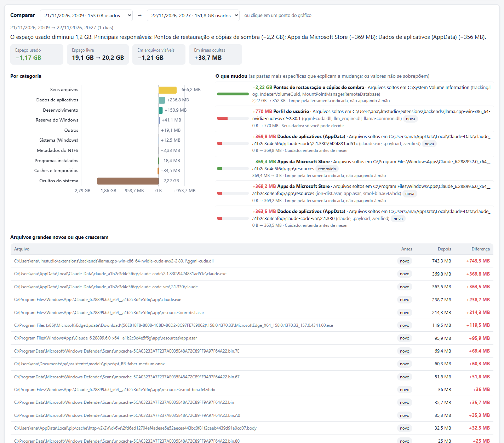

- um **resumo em texto** ("O espaço usado diminuiu 1,2 GB. Principais responsáveis: …");
- a variação por categoria e nas áreas ocultas;
- **as pastas mais específicas que explicam a mudança**, sem somar a mesma coisa duas vezes;
- os arquivos de 10 MB ou mais que surgiram ou cresceram;
- os eventos do Windows no período e os maiores saltos entre medições.

### Arquivo a arquivo (journal do NTFS)

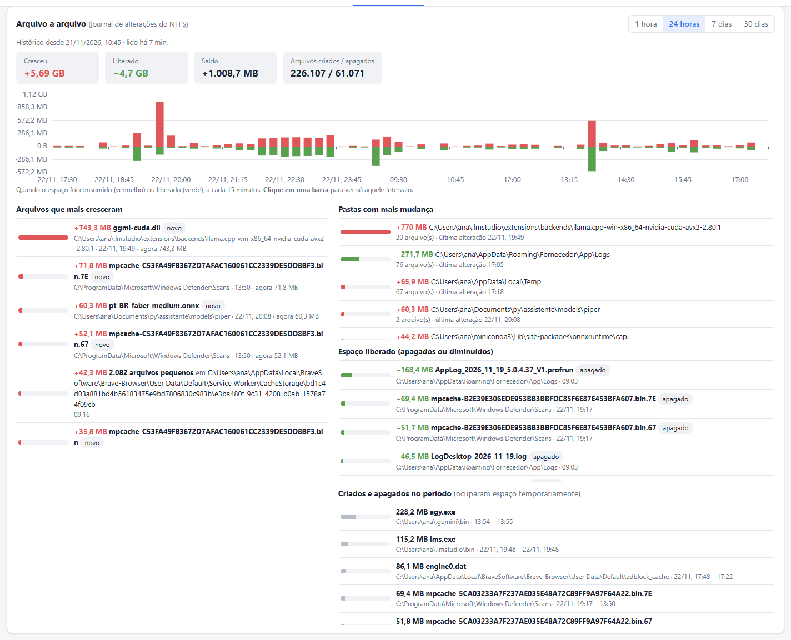

O NTFS registra cada arquivo criado, aumentado, diminuído ou apagado. A cada execução, o agente lê os registros novos, abre cada arquivo alterado pelo ID do NTFS e guarda a diferença de tamanho. O card mostra:

- quanto cresceu e quanto foi liberado na última hora, 24 horas, 7 ou 30 dias;
- **quando** o espaço foi consumido, a cada 15 minutos (clique numa barra para filtrar aquele intervalo);
- os arquivos que mais cresceram, as pastas com mais mudança e o espaço liberado;
- os arquivos que **ocuparam espaço temporariamente**: criados e apagados no período, como instaladores e atualizações. Esse é justamente o tipo de coisa que faz o espaço livre "piscar".

Ler o journal exige administrador. A tarefa agendada já roda assim, sem pedir nada no dia a dia.

### Assistente de IA (qualquer provedor)

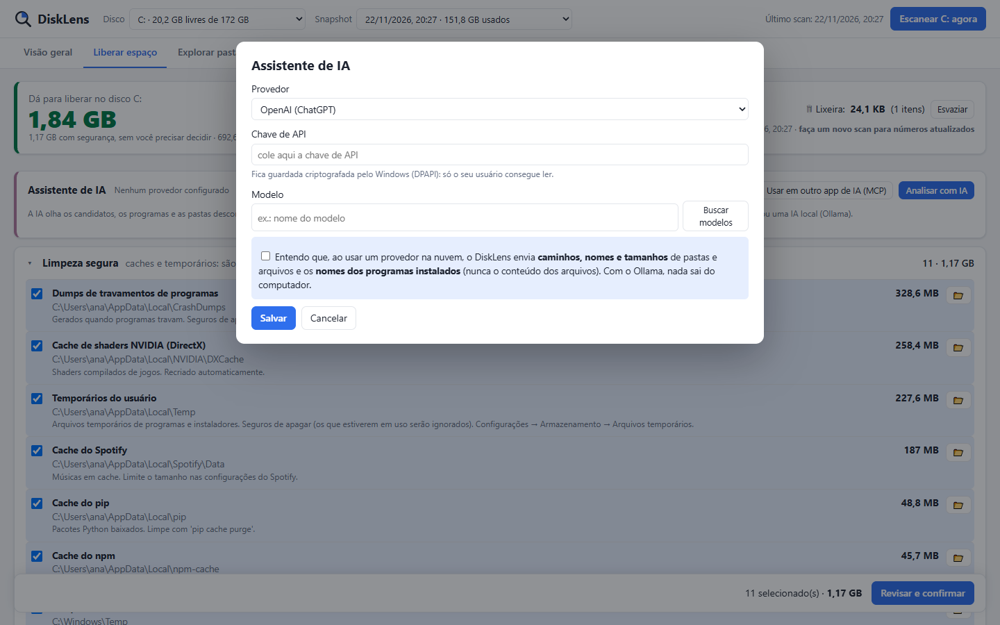

Em **Liberar espaço → Assistente de IA → Configurar**, escolha o provedor:

| Provedor | Observação |
|---|---|
| OpenAI | API `/chat/completions` |
| Google Gemini | endpoint compatível com OpenAI |
| DeepSeek | `api.deepseek.com` |
| Anthropic (Claude) | API `/messages` |
| Ollama | **local**: nada sai do computador |
| Personalizado | qualquer serviço compatível com a API da OpenAI |

O botão "Buscar modelos" lista os modelos da sua conta. A IA olha os candidatos, os programas e as pastas desconhecidas e recomenda **apagar / desinstalar / manter / revisar**, sempre com o motivo:

- só pode recomendar itens que o DiskLens listou: ids inventados são descartados;
- **nunca apaga nada sozinha**: você confirma antes de qualquer ação;
- a chave de API fica criptografada pelo Windows (DPAPI), e só o seu usuário consegue lê-la.

### Servidor MCP (usar a partir de outros apps de IA)

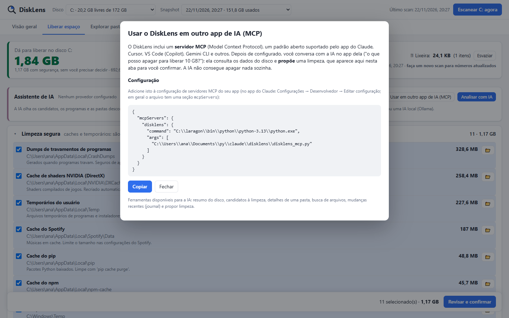

O DiskLens inclui um servidor [MCP](https://modelcontextprotocol.io) (Model Context Protocol), feito só com a biblioteca padrão do Python. Com ele, você conversa com a IA no app de sua preferência (app do Claude, Cursor, VS Code, Gemini CLI e outros):

> "O que posso apagar para liberar 10 GB?"

| Ferramenta | O que faz |
|---|---|
| `get_disk_overview` | uso por categoria, espaço oculto e Lixeira |
| `list_cleanup_candidates` | caches seguros, ferramentas, itens para revisar, programas e pastas desconhecidas |
| `get_folder_details` | tamanho, explicação, subpastas e maiores arquivos de uma pasta |
| `search_files` | busca por nome, extensão, idade, tamanho ou pasta |
| `get_recent_changes` | o que cresceu nas últimas N horas, arquivo a arquivo |
| `propose_cleanup` | cria uma **proposta**, já validada, que aparece na aba Liberar espaço para você confirmar |

**Não existe ferramenta que apague.** A configuração pronta para copiar fica em **Liberar espaço → Usar em outro app de IA (MCP)**.

### Ícone na bandeja

  

Opcional e **desligado por padrão**: liga em **Linha do tempo → Ligar ícone na bandeja**. O ícone é uma lupa sobre um gráfico de pizza do disco do sistema. A fatia mostra o espaço usado: **azul**, **laranja** acima de 85% e **vermelha** acima de 95%.

- **Clique:** abre o painel. **Botão direito:** espaço livre de cada disco, estado da coleta, "Medir agora", "Iniciar com o Windows" e "Sair".
- Fechar o painel deixa o ícone na bandeja. O ícone é um processo leve (cerca de 20 MB), e a janela, que usa o WebView2, só fica aberta quando você quer.
- "Iniciar com o Windows" não precisa de administrador.

### Tema escuro

Segue o tema do Windows automaticamente.

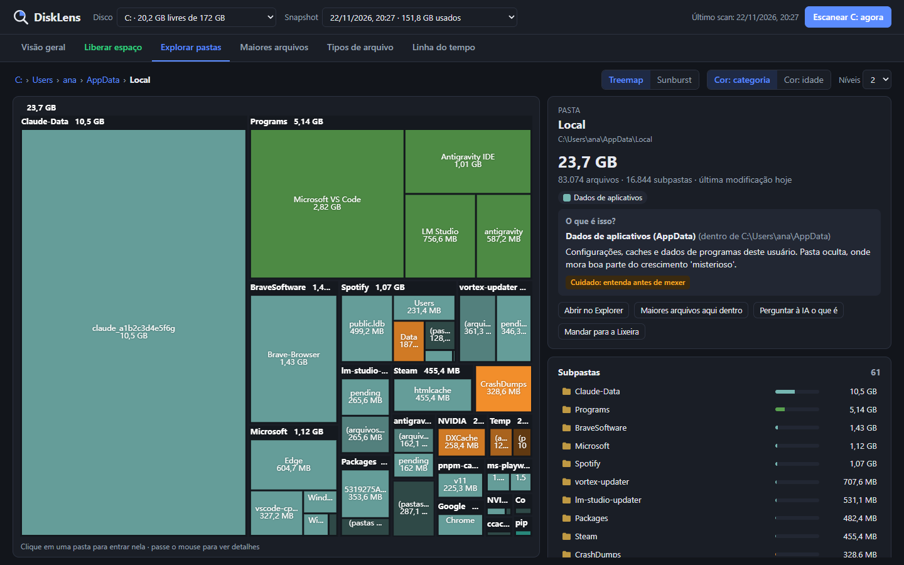

---

## Instalação

**Requisitos:** Windows 10 ou 11 e **Python 3.12 ou mais novo** ([python.org](https://www.python.org/downloads/)). A janela usa o Edge WebView2, que já vem no Windows.

1. Instale o Python marcando **"Add python.exe to PATH"**.
2. Baixe o projeto ([Code → Download ZIP](https://github.com/dionedde/disklens/archive/refs/heads/main.zip)) ou clone:
   ```bash
   git clone https://github.com/dionedde/disklens.git
   ```
3. Dê dois cliques em **`Instalar.bat`**. Ele cria o ambiente `.venv` (cerca de 20 MB) e instala a única dependência, o `pywebview`.

Não há compilador nem nada pesado: o scanner, o agente, a IA e o MCP usam só a biblioteca padrão do Python.

Na primeira execução, o `config.json` é criado e escolhe onde guardar os dados: por padrão, `X:\DiskLens\data` no disco **não-sistema** com mais espaço livre (para não encher o C:), ou `data\` dentro do projeto.

## Como usar

| Para… | Faça |
|---|---|
| Abrir | dois cliques em **`DiskLens.bat`** |
| Ver tudo, inclusive pastas protegidas (**recomendado**) | **`DiskLens (administrador).bat`** |
| Primeiro scan | botão **Escanear C: agora**: cerca de 1 minuto para ~740 mil arquivos |
| Liberar espaço já | aba **Liberar espaço**, confira os itens marcados, **Revisar e confirmar** |
| Descobrir por que o espaço sumiu | aba **Linha do tempo**, **Ativar coleta automática**. Depois de alguns dias, use **Comparar** e o card **Arquivo a arquivo** |
| Saber o que é uma pasta | aba **Explorar**, clique nela e leia "O que é isso?", ou use **Perguntar à IA o que é** |
| Usar a IA | **Liberar espaço → Assistente de IA → Configurar** |
| Usar no app do Claude, Cursor etc. | **Liberar espaço → Usar em outro app de IA (MCP)** e copie a configuração |

Só abre um painel por vez: abrir de novo traz a janela existente para a frente.

Para desativar a coleta automática, use o botão **Desativar** na Linha do tempo (ou `schtasks /Delete /TN "DiskLens\Agente" /F` como administrador).

---

## Segurança: o que o DiskLens nunca faz

As proteções (`cleaner.protection_reason`) são checadas **ao listar, ao propor e de novo logo antes de executar**. Elas valem para a interface, para a IA e para o MCP:

- nunca apaga a raiz do disco, `Windows`, `Arquivos de Programas`, `ProgramData`, pastas de programas instalados (lidas do registro), o Python e os dados do próprio DiskLens, pagefile/hiberfil, nem pastas do perfil inteiras;
- ao esvaziar um cache, **nunca segue junctions ou links** para fora dele;
- áreas marcadas "use a ferramenta" (WinSxS, Windows Update…) só são limpas pela ferramenta oficial;
- arquivos pessoais vão **para a Lixeira**, nunca são apagados direto;
- programas só saem pelo **desinstalador oficial**;
- tudo fica registrado no histórico (`cleanup_log`).

Um pedido para apagar algo protegido é recusado **mesmo vindo direto pela API local**, e a API só aceita chamadas com um token gerado a cada execução.

## Não atrapalha o uso do PC

O scan roda em processo separado, com a **prioridade mínima** de CPU, disco e memória (`PROCESS_MODE_BACKGROUND_BEGIN`), e **pausa sozinho** quando:

- um jogo ou app está em **tela cheia**;
- outros programas usam **mais de 60% da CPU** de forma constante;
- a memória passa de **90%**.

Ele retoma depois de 30 s de calma. O snapshot automático também é **adiado** nesses casos e quando o notebook está na bateria, com novas tentativas em 30 min, 1 h, 2 h e no máximo 4 h. Os limites são configuráveis na própria aba.

## Privacidade

- Tudo fica no seu computador. O DiskLens não tem servidor, conta, nem telemetria.
- A interface é servida em `127.0.0.1`, protegida por token.
- A IA só é usada se você configurar. Nesse caso, ela recebe **caminhos, nomes e tamanhos** de pastas e arquivos e os nomes dos programas, **nunca o conteúdo dos arquivos**. Um aviso pede o seu consentimento antes do primeiro uso. Com o Ollama, nada sai do computador.

---

## Como funciona por dentro

```
disklens/
  scanner.py     varredura multithread (os.scandir + ctypes): tamanho real em disco (clusters,
                 compactados, esparsos, WOF), hard links contados uma vez, OneDrive/placeholders = 0
  loadguard.py   pausa e retomada conforme a carga do PC
  probes.py      mede o espaço oculto e concilia com o scan
  agent.py       coleta a cada 15 min: medições, eventos, journal, snapshot com verificação de carga
  tasks.py       registra/remove a tarefa no Agendador de Tarefas
  usn.py         lê o journal do NTFS (FSCTL_READ_USN_JOURNAL) e mede cada arquivo alterado
  diff.py        compara dois snapshots e explica o que mudou, sem sobreposição
  rules.json     base de conhecimento: pasta -> categoria, explicação, segurança
  cleaner.py     proteções, esvaziar caches, Lixeira (SHFileOperation), ferramentas do Windows
  candidates.py  candidatos à limpeza e programas instalados (registro do Windows)
  proposals.py   propostas da IA/MCP e execução das ações confirmadas
  ai.py          assistente multi-provedor (só biblioteca padrão; chave com DPAPI)
  mcp_server.py  servidor MCP stdio (entrada: disklens_mcp.py)
  server.py      API local (127.0.0.1, com token)
  app.py         janela nativa (pywebview / Edge WebView2)
  tray.py        ícone na bandeja (ctypes / Win32)
  instance.py    instância única, painel e "Iniciar com o Windows"
  icon.py        desenha o ícone em código (ICO/PNG, sem imagens nem Pillow)
  web/           interface (HTML/CSS/JS + ECharts local)
```

**Dados** (em `data_dir`):

- `index.db`: snapshots, medições, eventos e histórico de limpeza.
- `snap_<id>.db`: um snapshot. O mais recente guarda todos os arquivos; os anteriores guardam as pastas e os arquivos de 10 MB ou mais. Depois de 90 dias, fica um snapshot por semana.
- `usn.db`: as mudanças lidas do journal.

**Detalhes de medição:**

- O tamanho de cada arquivo é o **espaço alocado no disco**, arredondado ao cluster. Arquivos compactados, esparsos e WOF são medidos com `GetCompressedFileSizeW`, e arquivos da nuvem (OneDrive) contam como 0.
- Arquivos com **hard links** (WinSxS ↔ System32, Edge ↔ EdgeWebView, pacotes do Conda…) são contados uma vez só.
- Junctions e links simbólicos nunca são seguidos.

## Testes

Os testes não precisam de administrador. Eles usam pastas descartáveis, um journal simulado e um servidor de IA falso, então nenhum serviço real é chamado:

```bash
.venv\Scripts\python.exe -m unittest discover -s tests -v
```

Há também um autoteste real do journal, que exige administrador: `python -m disklens.usn saida.json`.

## Perguntas frequentes

**Preciso deixar o DiskLens aberto para a coleta funcionar?**
Não. Quem roda a coleta é o Agendador de Tarefas do Windows. O ícone na bandeja é opcional.

**Por que "Liberar espaço" mostra menos do que eu esperava?**
Ela só lista o que pode ser apagado sem afetar seus programas ou o Windows. Arquivos pessoais aparecem em "Para revisar", e o resto é decisão sua, que a IA pode ajudar a tomar.

**Apaguei arquivos e o espaço livre não mudou. E agora?**
Arquivos pessoais vão para a Lixeira. O DiskLens avisa e oferece o botão **Esvaziar a Lixeira**.

**O scan conta mais ou menos espaço do que o Windows mostra.**
A diferença é explicada no card "Espaço que nenhuma pasta mostra". Sem administrador, algumas pastas protegidas ficam sem leitura e entram em "Não identificado".

**Funciona em outros discos?**
Sim: escolha o disco no topo. A coleta automática pode incluir outros discos nas configurações.

---

## Licença

Distribuído sob a licença [Apache 2.0](LICENSE).

<sub>As capturas de tela usam dados reais de um PC, com o nome do usuário e de pastas pessoais trocados por nomes genéricos.</sub>
